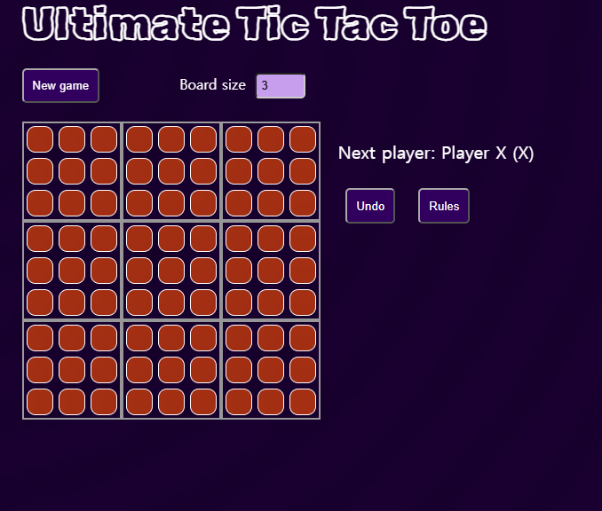

# Assignment 4-2 React Open Source Project Customizing & Deployment

22000640 장현우

# Project Information

- **프로젝트 소개:** 서양판 오목인 Tic-Tac-Toe 게임은 3x3의 크기의 보드에서 두 명의 플레이어가 x와 o를 번갈아가며 놓으며 먼저 한 줄을 완성한 플레이어가 이기는 게임입니다. Ultimate Tic-Tac-Toe는 해당 게임을 더 복잡하게 변형한 게임으로써, 각각의 칸이 작은 3x3 보드인 3x3 보드에서 두 플레이어가 번갈아가며 게임을 진행하는 게임입니다. 본 프로젝트는 React를 이용하여 해당 게임을 웹으로 구현하였습니다. 
- **선택 이유:** 게임 메카니즘이 꽤 복잡하기에 React의 상태 관리와 데이터 처리 방식을 실습해보는데에 도움이 될 것이라고 생각했습니다. 또한, 게임 종료시 화면이 깨지거나 보드 크기를 크게 설정한 후 브라우저 크기를 줄이면 보드가 깨지는 등 묘하게 엉성한 부분이 많은 점 역시 실습을 통해 직접 수정해볼 여지가 있다고 생각하여 선정하였습니다.

- **주요 기능:** 
1. **게임 보드 사이즈 조정:** 최소 3x3부터 최대 10x10까지 보드 크기를 설정하여 게임 진행 가능
2. **2인용 턴제 게임:** 두 플레이어가 pass-and-play 방식으로 x와 o를 번갈아 가며 두며, 승리 조건을 만족한 플레이어가 승리. 이 때, 이전 플레이어가 둔 수에 기반하여 다음 플레이어가 둬야할 위치가 설정되는 등, 게임의 로직 구현.
3. **게임 진행:** 새로운 게임 시작, 이전 수 되돌리기, 플레이어 이름 설정 등 편의 기능 제공.

- **원본 GitHub URL:** 
https://github.com/hallowshaw/Ultimate-Tic-Tac-Toe.git

- **라이선스:**
This project is licensed under the [MIT License](LICENSE).

## Installation

1. Clone the repository:

    ```bash
    git clone https://github.com/hallowshaw/Ultimate-Tic-Tac-Toe.git
    ```

2. Navigate into the project directory:

    ```bash
    cd Ultimate-Tic-Tac-Toe
    ```

3. Install dependencies:

    ```bash
    npm install
    ```

4. Start the development server:

    ```bash
    npm run dev
    ```

5. Open your browser and navigate to `http://localhost:3000` to play the game.



## Source Code Exploration
- **Project Structure:** 
1. **main.jsx:** React DOM 트리의 Root를 생성하고 앱을 렌더링하는 시작 포인트
2. **App.jsx:** 최상위 컴포넌트로써 앱의 구조를 설정하고 게임 설정, 플레이어 이름 및 새 게임 상태를 관리하는 파일 
3. **index.css:** 앱에 적용되는 CSS 서식용 파일 

- **React Component:**
1. **SettingsForm.jsx:** 사용자의 설정값을 입력받고 전달하는 컴포넌트
2. **Game.jsx:** 핵심 파일, Ultimate Tic-Tac-Toe의 게임 로직 구현용 컴포넌트. 게임의 상태와 승리 판정을 관리하고, 플레이어의 차례와 다시 되돌리기 등 게임의 전반적인 진행 담당
3. **Square.jsx:** 개별 칸을 관리하는 컴포넌트. 차례인 사용자에 따라 개별 칸에 클릭 이벤트를 전달함.

- **Code Analysis:** 
```bash
const handleClick = (inner_idx, outer_idx) => {
    const size = props.size;
    const history = state.history.slice(0, state.stepNumber + 1);
    const current = history[history.length - 1];
    const squares = current.squares.map((row) => row.slice());
    const localWinners = current.localWinners.slice();
    if (
      current.winner ||
      !isCurrentBoard(outer_idx) ||
      squares[outer_idx][inner_idx]
    ) {
      return;
    }
    squares[outer_idx][inner_idx] = current.xIsNext ? "X" : "O";
    const lastMoveLocation = {
      row: Math.floor(inner_idx / size),
      col: inner_idx % size,
      outerRow: Math.floor(outer_idx / size),
      outerCol: outer_idx % size,
    };
```
게임판의 특정 칸을 클릭했을 때 해당 클릭을 처리하는 함수. 사용자가 클릭한 칸의 좌표를 innder_idx와 outer_idx로 받아 handle한다. 이후 현재 게임 상태(각 칸의 상태, 작은 보드의 승리자 정보(localWinner)) 등을 복사해 가져와 세 가지 경우를 검사한다. 
1) 게임이 종료된 경우 
2) 현재 규칙상 선택할 수 없는 게임판을 클릭한 경우 
3) 이미 표시가 있는 칸을 클릭한 경우 

위 세 경우에는 함수를 즉시 종료한다. 
유효한 칸을 클릭한 경우에는, 현재의 차례를 검사해 x의 차례라면 x를, o의 차례라면 o를 표시하고 해당 위치를 lastMoveLocation으로 저장한다. 

## Customizing

- **Text:** Game.jsx, SettingsForm.jsx | 화면에 디스플레이된 각종 버튼 및 메시지, 그리고 게임을 승리하거나 무승부되었을 때 출력되는 메시지를 모두 한글화 진행 (New Game -> 새로운 게임, Board Size -> 보드 크기 등)
- **Style:** Square.jsx, index.css | 배경색 변경, 칸의 색상과 O, X 색, 작은 보드 승리시 색상 모두 변경
- **UI/Data:** 